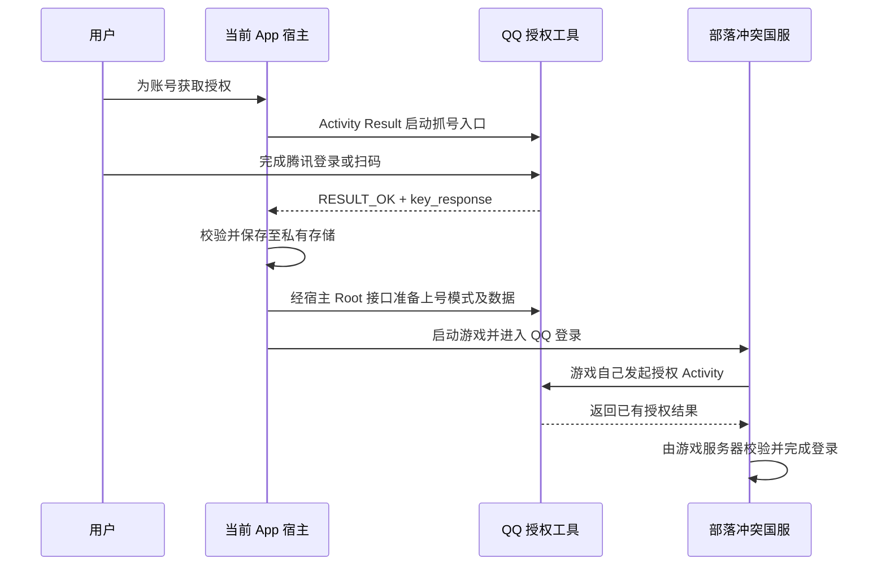

# QQ 授权工具 v1.4 与国服登录联动研究

分析日期：2026-10-18。目标：由当前 App 发起操作，让部落冲突国服完成本人 QQ 账号登录。

本文是最初静态研究阶段的记录。“没有修改应用代码”等表述仅指研究当时；后续实现与使用方法见 [QQ_AUTH_USAGE.md](QQ_AUTH_USAGE.md)。

## 结论和验证边界

这个 APK 提供了可利用的 Activity 返回结果及本地数据入口，可以设计联动。它使用 QQ 的包名和授权 Activity 类名，网页登录取得授权数据后返回给调用方；另一种模式将已有授权数据包装成相同结果。

“当前 App 收到授权”和“游戏接受授权并完成登录”是两个环节。前者有明确静态接口，后者尚需当前国服版本的设备验证，不能据此声称已经实现一键登录。

首次获取仍需用户在腾讯页面完成登录、扫码或验证。该 APK 没有实现自动刷新授权，也不能凭空产生有效凭据。

本次只增加研究文档，没有修改应用代码，也没有安装、卸载、启动目标 APK 或请求其授权 URL。`adb devices -l` 没有返回设备。

## 样本和证据来源

| 项目 | 结果 |
| --- | --- |
| 文件 | `QQ授权工具v1.4卸载QQ才能安装.apk` |
| 大小 | 76,067 字节 |
| SHA-256 | `d90d7c9b9116f8d5f1dfb27dc3ad3a9312640766380384f80601c8b8c38e0731` |
| 包名 | `com.tencent.mobileqq` |
| 显示名 | QQ授权工具v1.4 |
| versionName / versionCode | `9.9.99` / `1` |
| minSdk / targetSdk | 19 / 29 |
| debuggable / allowBackup | true / true |
| 签名证书 SHA-256 | `a40da80a59d170caa950cf15c18c454d47a39b26989d8b640ecd745ba71bf5dc` |

REA 的 `inspect_android_package` 返回 `capability_unavailable`，原因是没有配置 `jadx-headless-mcp 0.7.1` JAR。实际分析来自已有 JADX 1.5.5、Android SDK 36.0.0 的 aapt/apksigner，以及项目源代码；下面的 S 编号是本报告的本地证据编号，不是 REA Evidence ID。

反编译与清单证据保存在 [QQ_AUTH_STATIC_EVIDENCE.md](QQ_AUTH_STATIC_EVIDENCE.md)。

| 编号 | 来源 | 支持的结论 |
| --- | --- | --- |
| S1 | APK 解码 Manifest、aapt badging | 包名、导出入口、SDK、组件声明 |
| S2 | `MainActivity.onCreate` | 两种模式及 `ms/pd_key` 的取值 |
| S3 | `AgentActivity.onCreate` | 固定授权 URL、文件输入、自动回传 |
| S4 | `AgentActivity.MyWebViewClient` | `auth:` 回调、原文保存、结果构造 |
| S5 | `AgentActivity.sh` 和 SharedPreferences 辅助方法 | 手动回传与缓存 |
| S6 | 当前项目源码 | 现有 UI、启动流程及宿主 Root 接口 |

## APK 的实际接口

### 入口和模式

授权入口组件为：

```text
com.tencent.mobileqq/com.tencent.open.agent.AgentActivity
```

该 Activity 明确声明 `exported=true`。代码没有读取 `getIntent()` 参数；不能通过臆造 `mode`、`appid`、`token` extra 来控制它。（S1、S3）

模式来自工具自身的 SharedPreferences `ms`：

| `pd_key` | 行为 |
| --- | --- |
| 不存在 | 打开网页登录，获取授权 |
| `"1"` | 上号模式：读取已有数据并尝试自动返回 |
| 其他值，UI 设置为 `"2"` | 打开网页登录，获取授权 |

`MainActivity` 只是模式选择页，授权逻辑在 `AgentActivity`。（S2、S3）

### 获取授权

WebView 加载 `https://xui.ptlogin2.qq.com/cgi-bin/xlogin`，固定 `client_id` 和 `pt_3rd_aid` 为 `1105771533`，重定向为 `auth://tauth.qq.com/`。URL 包含写死的 `time`、`sign`、`h5sig`、SDK 版本和设备信息；没有按调用方动态构建参数。（S3）

收到 `auth:` 导航后，工具按顺序执行：（S4）

1. 将完整回调保存到 `shwj` SharedPreferences 的 `raw_text`。
2. 尝试覆盖写入共享存储根目录的 `抓取的数据.txt`。
3. 用固定正则解析授权字段，成功后通过 `setResult(RESULT_OK, intent)` 返回并关闭 Activity。

返回 Intent 的 extra 名称是 `key_response`，值为 JSON 字符串：

```json
{
  "access_token": "<授权值>",
  "openid": "<用户标识>",
  "pay_token": "<授权值>",
  "expires_in": "<有效期秒数>",
  "ret": "0",
  "pf": "desktop_m_qq-10000144-android-2002-",
  "page_type": "1"
}
```

`ret=0` 是工具自己设置的值，只代表它完成了本地结果构造，不代表腾讯或游戏服务器已接受登录。

### 使用已有授权

上号模式优先读取 `Environment.getExternalStorageDirectory()/aw_temp.txt`；文件不存在或读取异常时，使用 `shsj/raw_text`。符合固定正则即自动返回同样的 `key_response`。保存成功的输入也会写入 `shsj/raw_text`。（S3、S5）

工具要求原始文本中的字段连续按以下顺序出现，最后还要有 `&`：

```text
access_token=<值>&expires_in=<值>&openid=<值>&pay_token=<值>&
```

这说明只写 JSON 给 `aw_temp.txt` 无效。工具没有 URL 解码及健壮的字段解析，格式、字段顺序变化都可能让它停留在界面。宿主解析授权应使用 URI/参数解析器；需要兼容工具输入时，再生成其要求的格式。

`shwj/raw_text` 是抓取缓存，`shsj/raw_text` 是上号缓存，不能混用。共享存储根目录的 `txt` 虽然被读取两行，但结果没有进入授权或网络流程；`pd.txt` 只出现在未使用的常量中。`TcpClient` 为空类，Socket 等字段没有形成通信实现；没有可用 TCP、HTTP 或广播授权服务。（S2—S5）

## 当前项目现状

可复用的部分：（S6）

- `core/util/basic/ServerShell.kt`、`RunShell.kt`：通过宿主内部 Root worker 执行命令。
- `core/data/websocket/ServerActions.kt`：`file_action/read/write` 等请求走私有管道。目录名虽然带 websocket，当前实际传输是 `LocalActionTransport` 启动的 Root `app_process` stdin/stdout。
- `core/system/local/RootActionProcess.java`：已有文件原子写入；替换已有文件时保留 UID/GID 和权限，但没有复制原文件的 SELinux 标签，新文件也没有自动指定目标 App UID。
- `core/system/screencapture/ProjectionPermissionHelper.kt`：可参考现有 Activity Result 生命周期用法。
- `jar/ui/pages/single/AccountConfig.kt`：启动方式 UI 当前只开放“游戏存档”“直接启动”；`"2" -> UseDataPackage` 和“数据号内容”仍保留，但不可正常从下拉框选入。
- `jar/code/universal/smalltools/WriteGameFiles.kt:72`：启动方式非 0 直接跳过存档写入，没有实现 QQ 授权准备。
- `jar/code/MainScript.kt`：在进入游戏前执行 `writeGameFiles()`，是增加授权准备流程的候选位置。

当前 Manifest 没有 QQ 的 queries 项，也没有专用授权桥接 Activity。没有发现读取上述工具输入/输出、处理 `key_response` 或执行 QQ 登录切换的实现。不能仅恢复下拉框第三项就认为功能已接通。

## 建议的联动流程

先以现成工具完成单账号验证，再接入账号轮换。以下都是设计建议，不是已运行行为。



### 第一步：验证游戏能否直接调用工具

在明确允许替换 QQ 的测试设备上，工具设为抓号模式，用户从游戏点击 QQ 登录。如果游戏能够拉起此工具，完成网页登录后应直接把结果交回游戏。这个实验比先实现完整管理 UI 更能判断当前版本兼容性。

不能在用户常用设备上自动卸载 QQ。样本与 QQ 包名相同，普通 Android 安装规则不允许同一包名的两个 APK 并存；签名不匹配时也不能直接覆盖。工作资料或多用户并不自动解决整机同包签名冲突。

### 第二步：由当前 App 管理授权

增加宿主拥有的 `QqAuthorizationActivity`，用 Activity Result API 显式启动工具入口并接收结果。插件只通过宿主接口请求操作；新增 Android Activity 必须在宿主 APK Manifest 注册，单独热更新 JAR 无法增加注册组件。

弹窗/悬浮窗触发时，由宿主负责进入合法的前台 Activity 生命周期。仅用 `am start` 打开工具不会把其 Activity 返回值交给当前 App。

返回结果校验必要字段，记录本地 `capturedAt` 和 `expiresAt = capturedAt + expires_in`。首次采集可用该方式估算到期时间；重放同一份数据时不能重新延长到期时间。仅把返回 JSON 改写为工具需要的字段顺序，不改变授权字段的内容。

建议增加宿主私有授权仓库，普通账号配置只保存授权记录 ID。已有 `DATA_CONTENT` 可以作为迁移线索，但它属于普通设置，不宜直接承担长期令牌仓库。调试使用 `ShowMessage`，仅记录阶段、账号序号和错误码，避免输出完整授权原文。

### 第三步：准备并触发游戏登录

工具未提供模式切换公开接口。最小验证可让用户在其主页切换；如需自动化，需在工具停止后，经宿主 Root 接口更新它的偏好设置，保留其他键、UID/GID、权限及 SELinux 标签，随后重新启动。

授权输入可先验证 `aw_temp.txt` 路径；如果设备的共享存储策略阻止工具读取，则验证其已有 `shsj/raw_text` 私有缓存回退路径。宿主有 Root 写权限，并不意味着工具自己的普通进程就能读取共享存储文件。

不直接复用 `FileHelper.readJson()` 读取 XML 或原始回调：该封装只接受 JSON 对象；应由宿主提供文本/XML操作封装，内部继续调用已有 `ServerActions` 文件请求。授权内容通过私有请求的 content 字段传递，不拼到 Shell 命令里。

准备完成后启动游戏，进入 QQ 登录，让游戏自身调用工具。**当前 App 先前收到的 Activity Result 不能直接转发给任意游戏 Activity。** 工具必须是这次游戏授权请求的被调用方，才可能沿正确结果链交回游戏。

多账号操作需要串行执行；该工具只有一份模式设置、一份 `aw_temp.txt` 和一份上号缓存。每次使用前替换为所选账号的数据，失败和取消时停止后续切换，避免旧账号数据被误用。

## 必须验证的限制

| 问题 | 当前证据 | 对方案的影响 |
| --- | --- | --- |
| 当前国服 SDK 是否接受这个包和入口 | 未提供游戏 APK；没有连接设备 | 可能存在 QQ 签名校验、不同入口或不同回调协议 |
| 固定 client_id 是否匹配当前国服渠道 | 仅观察到 `1105771533` | OpenID/Token 与应用身份有关，不能假定任意 QQ 授权均可使用 |
| 写死的网页登录 URL 是否仍有效 | 只有静态代码 | 旧签名、时间、页面流程可能已失效 |
| 游戏是否接受 `key_response` 中的字段 | 工具本地构造已确认 | 服务器可能拒绝、要求补充字段或重新授权 |
| 自动切号是否仍会触发 QQ 登录 | 当前项目主要使用存档和直接启动 | 现有游戏会话可能优先恢复旧账号，需单独验证退出/切换流程 |
| 外部文件是否可读写 | targetSdk 29，未声明 requestLegacyExternalStorage | Android 10+ 的分区存储和设备策略可能阻断根目录文件 |
| 无网络刷新和有效性验证 | 未发现 refresh_token 或刷新实现 | 到期或被撤销时必须重新授权 |

工具写文件采用覆盖模式，无法当成可靠的多账号历史库；文件写入异常会被打印后继续。宿主应优先接收 `key_response`，不要把“抓取的数据.txt 存在”当成此次授权成功。

不建议现阶段直接把工具 WebView 搬进项目并删除工具依赖：即便当前 App 自行取得授权，如何让当前游戏接受结果仍没有解决。同样，接入当前 App 自己的 QQ SDK/AppID 也不能自动替代游戏渠道所需的授权身份。

## 验证顺序与通过标准

1. 记录测试设备 Android 版本、游戏版本/渠道及 QQ 安装情况；保留现有账号会话，使用明确可替换 QQ 的设备。
2. 游戏手动 QQ 登录：确认调用工具入口、完成腾讯授权、服务器实际进入预期账号。只弹出“上号成功”不算通过。
3. 当前 App 发起工具授权：确认成功、取消、登录验证失败都能正确收尾，并能在私有仓库保存结果。
4. 使用刚取得的数据进入工具上号模式，由游戏主动调用；确认再次进入同一账号。
5. 验证两个本人账号依次切换、已有会话、到期/撤销数据、进程重启及共享存储不可用情况。
6. 上述闭环通过后，再扩展 `START_METHOD` 的 QQ 授权选项和插件主循环，不影响原有存档方式。

本次完成了 APK 静态接口识别、项目接入位置分析及验证方案。实际国服登录兼容性保持未验证状态。
